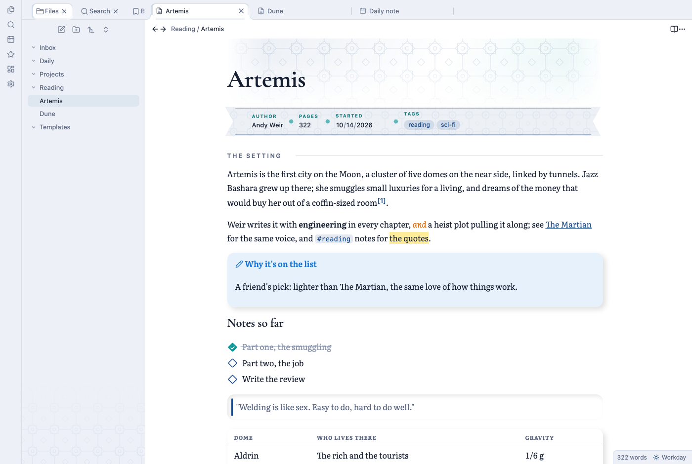
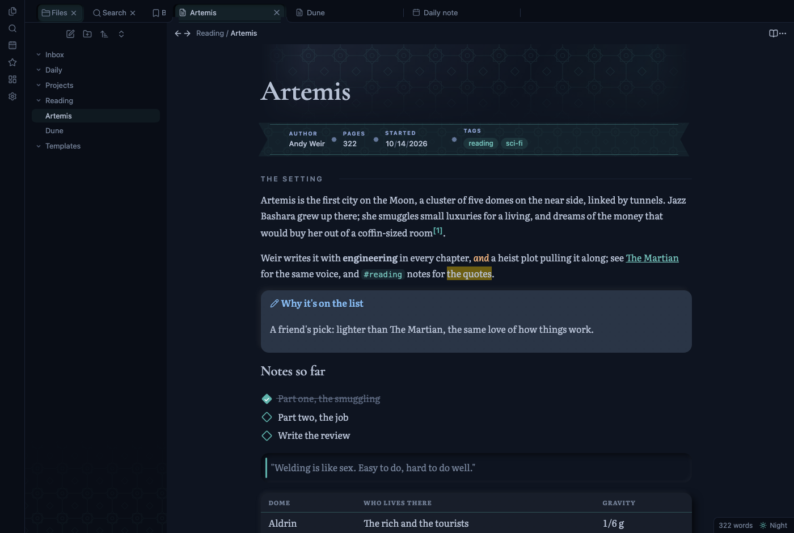
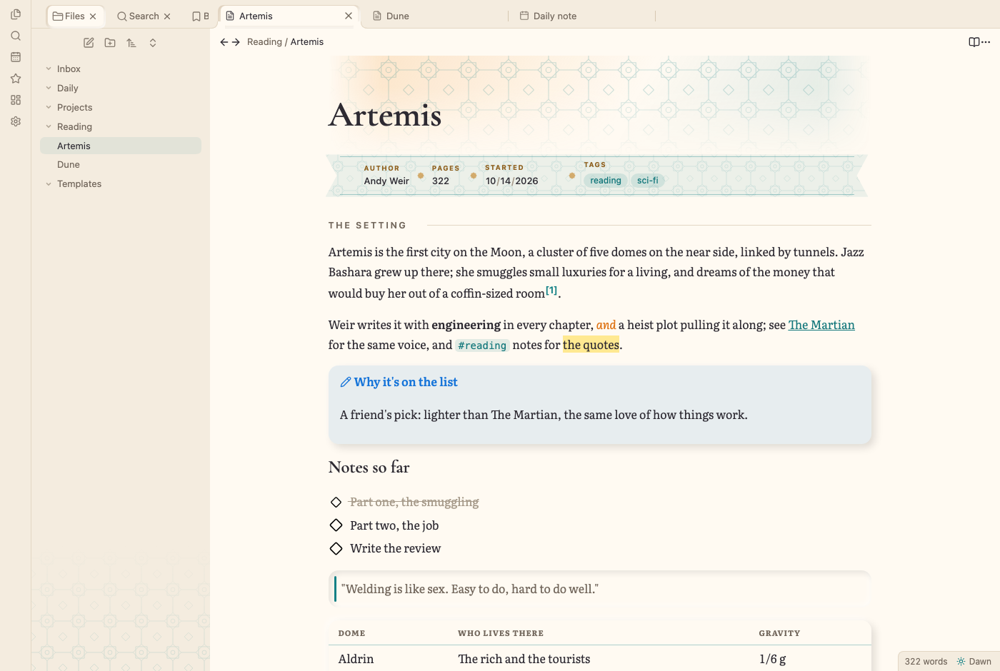
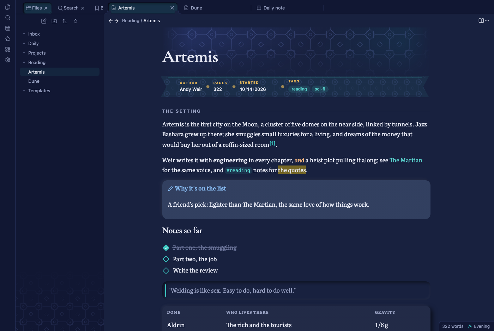
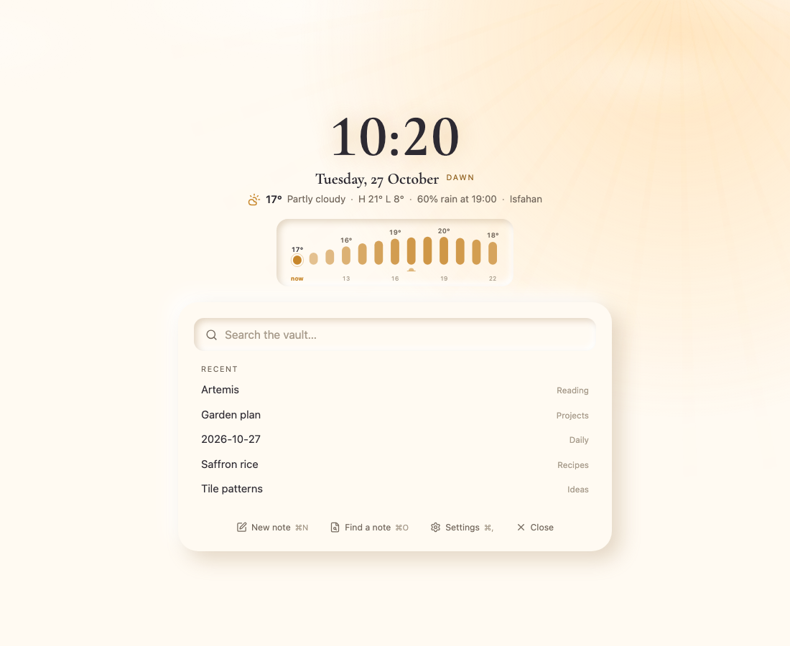

# Isfahan

Persian tilework for Obsidian. Lapis and turquoise palettes that follow the sun where you live, tile patterns from Persian architecture, serif type, and a reading view that looks like a printed book.

I built Isfahan for my own vault. This is the same look, separated from my own notes and setup so it works in any vault.

| Workday | Night |
|---|---|
|  |  |

## Four phases, set by the sun

Isfahan works out sunrise and sunset for your place, on your computer, and moves through four palettes in a day:

| Phase | When | Look |
|---|---|---|
| Dawn | the three hours after sunrise | warm paper and turquoise |
| Workday | from then until sunset | crisp lapis and turquoise |
| Evening | the two hours after sunset | deep indigo and gold |
| Night | from then until sunrise | midnight blue and moonlit turquoise, in low contrast |

Dawn and Workday are light; Evening and Night are dark, and Obsidian's light and dark mode switch with them. The status bar shows the current phase. Click it to pick another, which holds until the next change, or run **Follow the sun** to hand control back.

A new install starts at the main city of your computer's time zone, which is close enough for a first day. For your real sunrise, set your town under **Settings → Isfahan → Place**.

| Dawn | Evening |
|---|---|
|  |  |

## What it changes

### Tile motifs

A tile band sits behind each note's title, the file explorer gets a faint lattice, checkboxes turn into diamonds, and `[!mihrab]` callouts get an arch. There are seven patterns to choose from: Girih lattice, Star & cross, Shamseh rosettes, Rings, Jali screen, Banna'i fret and Quiet dots.

### Fonts

Titles, H1 and H2 are set in Cormorant Garamond, and the text of pages in Literata. Turn **Serif headings** off and titles take a rounded sans-serif instead. Both fonts cover Latin text only, so other scripts keep your own font.

### Page mode

In Reading view, a note reads like a printed page. Footnotes move into the margin beside the line that cites them, the first paragraph after the first `##` heading opens with a drop cap, and a thin line along the top tracks how far you've read. While you read, the sidebars, tabs and status bar fade until you hover over them. Editing view is left alone.

Page mode covers every note by default. If you'd rather opt in note by note, set it to page notes only and add `page` to a note's `cssclasses`.

### Property ribbon

In Reading view, the Properties block becomes a single line in the phase's colors. Pick Tile ribbon, Slim ribbon or Seals, or turn it off to get soft raised cards instead.

### The finish

The smaller pieces Obsidian draws get the same soft, raised treatment. Callouts become cards in their own color, quotes sit in pressed-in panels with an accent bar, tables become cards with small-caps headers, and tags and inline code turn into chips. Tabs and ribbon buttons press in when you use them.

### A new tab

An empty tab shows the time, the date and the phase, the weather for the next 12 hours, a search over the vault, and the notes you opened last. With **Weather** set to **Text and sky**, the sky behind it follows the forecast.



Isfahan looks its best on Obsidian's default theme. On top of another theme, the colors follow the phase but the theme's layout stays, so how well the two get along depends on the theme.

## A sample page and three templates

To see everything at once, run **Create a sample page** (or use the button at the top of Isfahan's settings). It writes a new note where your new notes go and opens it in Reading view, so you can switch to editing view and see how each part is written. Delete it when you're done.

The [templates](templates/) folder has three starting points: [Book](templates/Book.md) (author, pages, a pull quote, quotes) and [Long-read](templates/Long-read.md) (sections, margin notes, a quote callout) for notes that read as pages, and [Daily](templates/Daily.md) (a plan, notes, a line of the day, an end-of-day check) for daily notes. Copy them into your templates folder; they use the date syntax of Obsidian's core Templates plugin. To use Daily for every new daily note, pick it under **Settings → Daily notes → Template file location**.

## Note classes

Add these to a note's `cssclasses` property:

| Class | Effect |
|---|---|
| `page` | Page mode for this note, when Page mode is set to page notes only |
| `no-page` | Never Page mode for this note |
| `no-band` | No tile band behind the title |
| `no-inline-title` | Hide the note's title |
| `no-properties` | Hide the Properties block |

Two callouts get their own look as well: `[!mihrab]` gets an arch when tile motifs are on, and on pages `[!pull]` turns into a pull quote.

## Commands

**Create a sample page**, **Turn the look on or off**, **Follow the sun**, **Use Dawn**, **Use Workday**, **Use Evening**, **Use Night**, **Next tile pattern** and **Next property ribbon style**. None has a hotkey until you give it one.

## Install

Once Isfahan is in the community directory, open **Settings → Community plugins → Browse**, search for Isfahan, then choose **Install** and **Enable**.

To install by hand, download `main.js`, `manifest.json` and `styles.css` from the [latest release](https://github.com/saeed1262/isfahan-look/releases/latest) into `<your vault>/.obsidian/plugins/isfahan-look/`, then turn Isfahan on under **Settings → Community plugins**.

Isfahan runs on desktop only for now. It hasn't been tried on phones or tablets, and I'd rather not ship it there untested.

## Privacy and network use

Isfahan goes online for two things, and both go to [Open-Meteo](https://open-meteo.com), a free weather service that needs no account or key.

When you search for a town in the settings, the name you type goes to Open-Meteo's geocoding service. While a new tab is open, your place's latitude and longitude go to its forecast service, at most once every 30 minutes. Set **Weather** to **Off** and Isfahan fetches nothing.

Everything else stays on your computer. Sunrise and sunset are calculated locally, the fonts are built into the plugin, and there is no analytics or telemetry of any kind.

## Support

Isfahan is free. If it makes your vault a nicer place to work, you can [buy me a coffee on Ko-fi](https://ko-fi.com/saeedghorbani70608). Bug reports and ideas are welcome in the [issues](https://github.com/saeed1262/isfahan-look/issues).

## Building from source

```sh
npm install
npm run build        # src/ into main.js and styles.css
npm test             # the build, the privacy check, load and unload
npm run look         # screenshots of a sample page in every phase (needs Google Chrome)
npm run look:newtab  # the same for the new tab
```

`main.js` and `styles.css` are committed, and the tests fail if they're out of date with `src/`.

## License

The code is under the [MIT license](LICENSE). The bundled fonts are subsets from [Fontsource](https://fontsource.org), each under the SIL Open Font License 1.1: Cormorant Garamond and Literata. Their copyright notices and the license text are in [src/fonts/OFL.txt](src/fonts/OFL.txt) and at the top of `main.js`. The time-zone coordinates come from the tz database, which is in the public domain.
